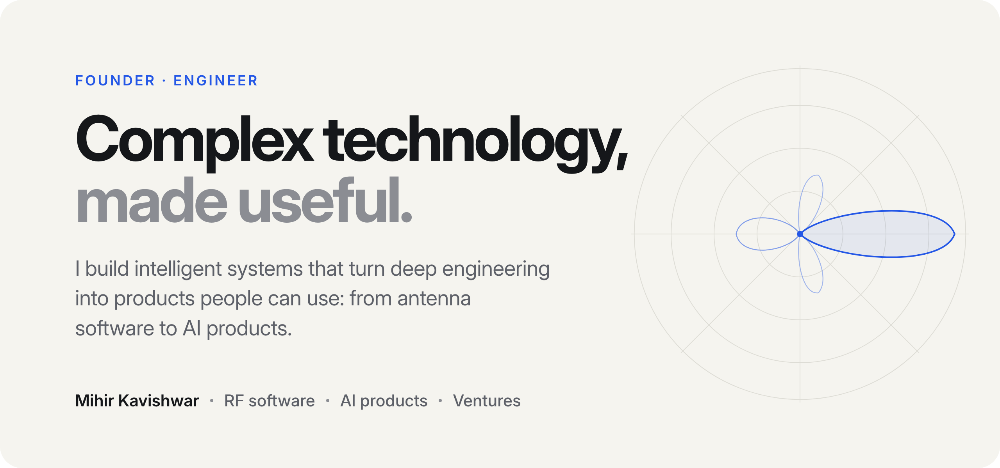
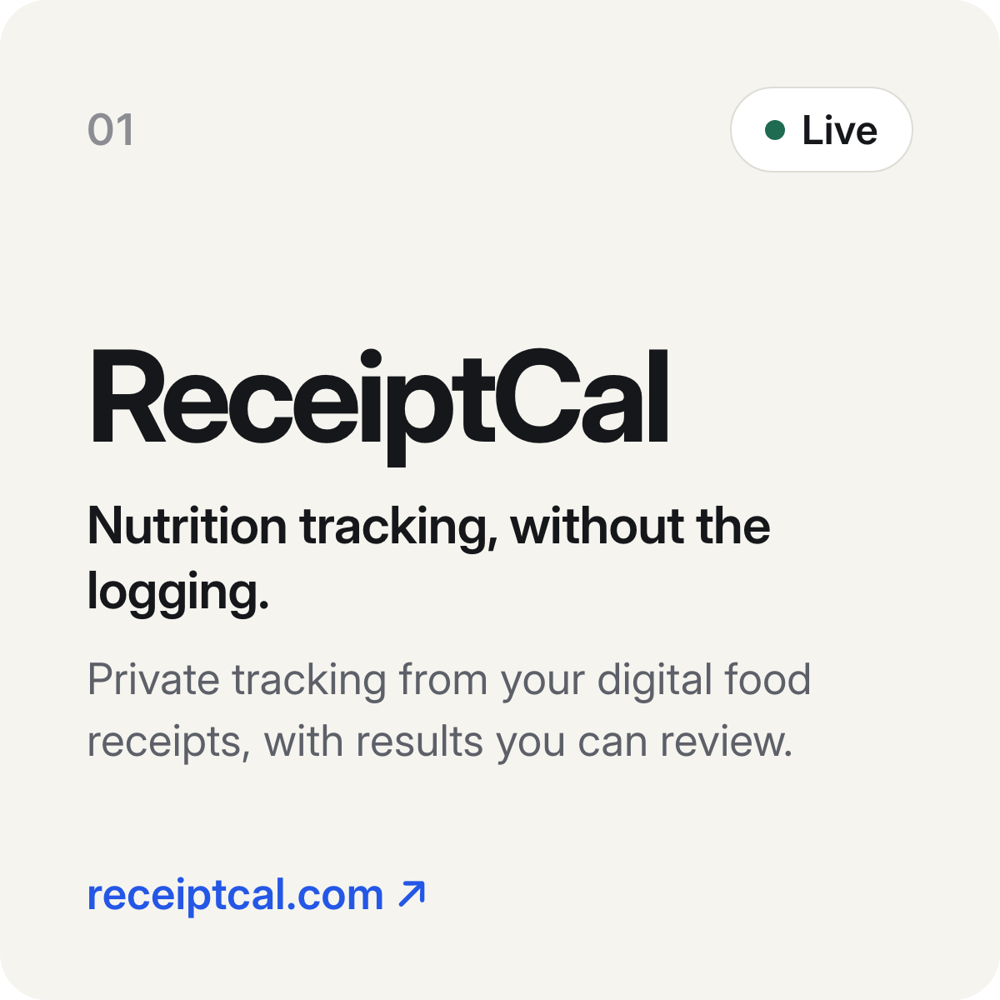
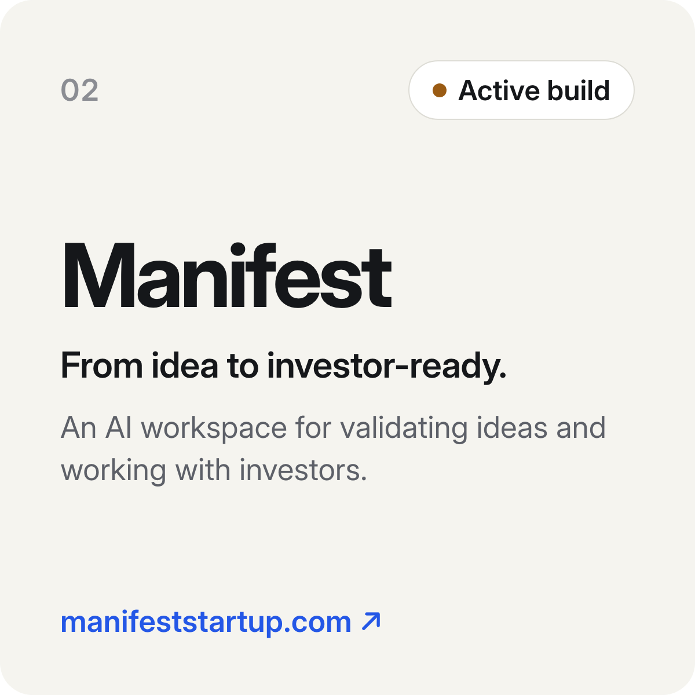
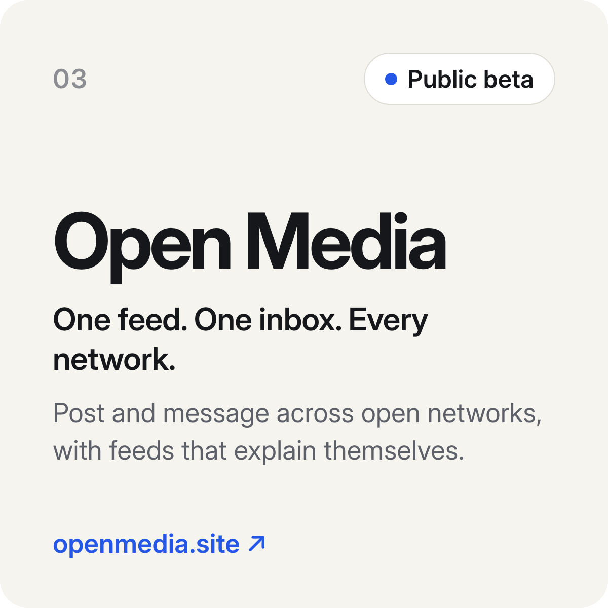
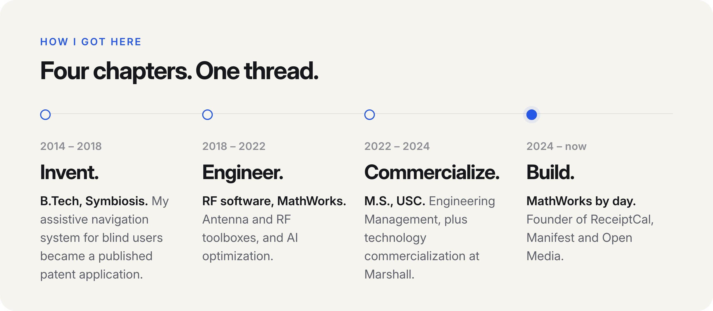

<!-- GitHub profile README for @mihirkavi. Design and copy follow mihirkavishwar.com. Image sources: assets/source/banners.html (render with scripts/render.py). -->

<a href="https://www.mihirkavishwar.com">
  <picture>
    <source media="(prefers-color-scheme: dark)" srcset="./assets/hero-dark.png">
    
  </picture>
</a>

  <a href="https://www.mihirkavishwar.com"><b>Portfolio</b></a> ↗ &nbsp;·&nbsp;
  <a href="https://www.linkedin.com/in/mihirkavishwar"><b>LinkedIn</b></a> ↗ &nbsp;·&nbsp;
  <a href="https://cal.com/mihirkavishwar/30min"><b>Book a call</b></a> ↗ &nbsp;·&nbsp;
  <a href="mailto:hello@mihirkavishwar.com"><b>Email</b></a> ↗ &nbsp;·&nbsp;
  <a href="https://www.mihirkavishwar.com/feed.xml"><b>RSS</b></a> ↗

 

<b>WHAT I’M BUILDING</b>

<h2 align="center">Three products. Less friction.</h2>

Products exploring how AI and thoughtful engineering can make everyday tasks easier.

  <a href="https://receiptcal.com"><picture><source media="(prefers-color-scheme: dark)" srcset="./assets/receiptcal-dark.png"></picture></a>
  <a href="https://manifeststartup.com/home"><picture><source media="(prefers-color-scheme: dark)" srcset="./assets/manifest-dark.png"></picture></a>
  <a href="https://openmedia.site"><picture><source media="(prefers-color-scheme: dark)" srcset="./assets/openmedia-dark.png"></picture></a>

  <a href="https://www.mihirkavishwar.com/work/receiptcal">ReceiptCal case study</a> ↗ &nbsp;·&nbsp;
  <a href="https://github.com/mihirkavi/open-media">Open Media source</a> ↗ &nbsp;·&nbsp;
  <a href="https://www.mihirkavishwar.com/work">All work</a> ↗

 

<picture>
  <source media="(prefers-color-scheme: dark)" srcset="./assets/chapters-dark.png">
  
</picture>

The common thread is translation: from electromagnetic models to tools engineers use, from fragmented data to accountable systems, and from ambitious ideas to working products. I’m most useful where a problem crosses boundaries: architecture and interface, model and workflow, technical feasibility and commercial value.

 

<b>ENGINEERING THAT SHIPPED</b>

<h2 align="center">Tools engineers use every day.</h2>

Before founding, I built RF and antenna design software in MATLAB. Some of that work is documented publicly.

| Shipped work | Source |
|:--|:--|
| **AI-assisted antenna optimization**  Surrogate-model optimization inside MATLAB antenna workflows. | [Example](https://www.mathworks.com/help/antenna/ug/maximizing-gain-and-improving-impedance-bandwidth-of-e-patch-antenna.html) ↗ |
| **Genetic-algorithm patch miniaturization**  Shrinking a microstrip patch antenna with optimization. | [Example](https://www.mathworks.com/help/antenna/ug/miniaturize-rectangular-microstrip-patch-antenna-using-genetic-algorithm.html) ↗ |
| **Antenna Array Designer**  Interactive design and optimization of antenna arrays. | [Example](https://www.mathworks.com/help/antenna/gs/design-and-analysis-using-antenna-array-designer-app.html) ↗ |
| **Fractal and J-dipole antennas**  Catalog elements that began as my MathWorks internship project. | [Reference](https://www.mathworks.com/help/antenna/ref/fractalkoch.html) ↗ |
| **Assistive navigation for blind users**  AI and haptic feedback, from my undergraduate final-year project. | [WO2019198064](https://patentscope.wipo.int/search/en/WO2019198064) ↗ |

[Read the antenna design case study](https://www.mihirkavishwar.com/work/antenna-design) ↗

 

<b>IDEAS AND WRITING</b>

<h2 align="center">Ideas from the work, and beyond.</h2>

| Essay | Published |
|:--|--:|
| [**Why Quantum Computers Will Power the AI Era**](https://www.mihirkavishwar.com/blog/posts/quantum-computers-next-computing-champion) | Feb 2026 |
| [**Quantum Computing 1: Breaking Down the Process**](https://www.mihirkavishwar.com/blog/posts/quantum-computing) | Mar 2024 |
| [**AI for Legacy Code**](https://www.mihirkavishwar.com/blog/posts/ai-legacy-code) | Jan 2024 |
| [**Combatting Deepfakes**](https://www.mihirkavishwar.com/blog/posts/combatting-deepfakes) | Jan 2024 |

[Read all writing](https://www.mihirkavishwar.com/blogs) ↗

 

<b>Toolkit</b>

 

**Languages and ML:** MATLAB, Python, Swift, TypeScript, C++, PyTorch, scikit-learn 
**RF and wireless:** Antenna Toolbox, RF Toolbox, RF PCB Toolbox, Phased Array System Toolbox, 5G Toolbox, Simulink 
**Platforms:** Cloudflare, Docker, Xcode, GitHub Actions, PostgreSQL

 

<b>CONTACT</b>

<h2 align="center">Let’s talk.</h2>

Building something ambitious? Book a call or send me a note.

  <a href="https://cal.com/mihirkavishwar/30min"><b>Book a call</b></a> → &nbsp;&nbsp;&nbsp;
  <a href="mailto:hello@mihirkavishwar.com?subject=Hello%20from%20GitHub"><b>Email me</b></a> ↗

